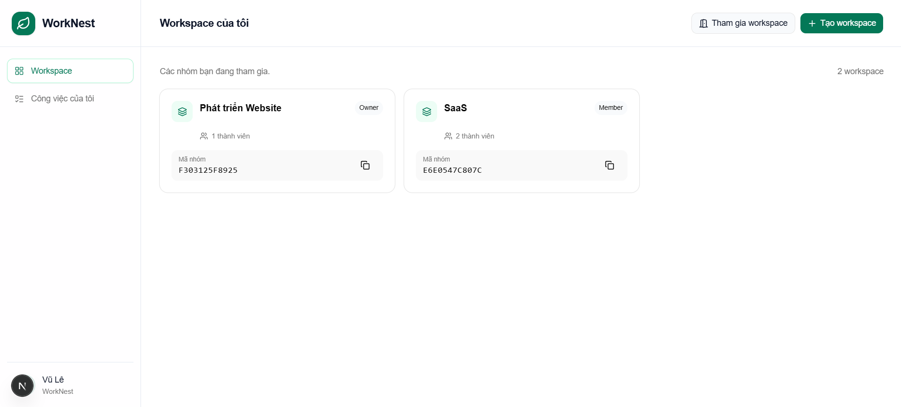
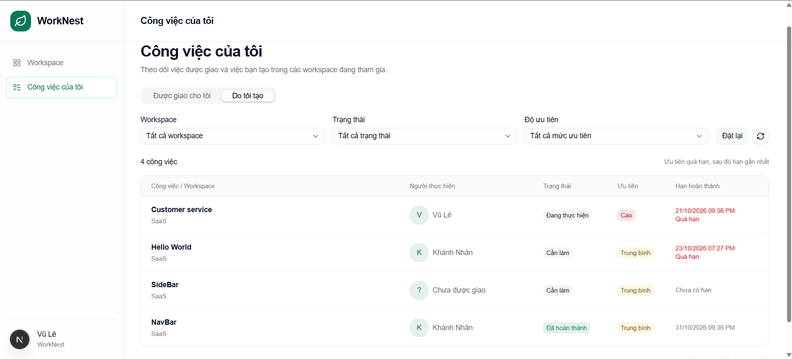
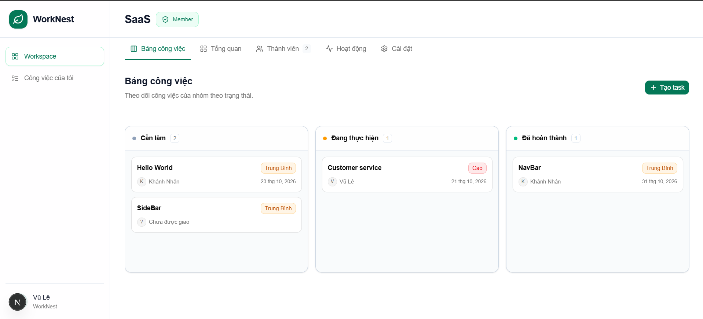

# WorkNest

<!-- Document implemented behavior; production and manual checks remain explicit. -->

Ứng dụng quản lý công việc nhóm với workspace, Kanban và cộng tác realtime.
Dự án cá nhân phục vụ học tập và portfolio thực tập.

## Giao diện

<!-- Dùng đường dẫn tương đối để ảnh hiển thị cả trên GitHub và khi xem local. -->

### Workspace của tôi

Danh sách nhóm đang tham gia, vai trò, mã nhóm và thao tác tạo/tham gia workspace.



### Công việc của tôi

Theo dõi task được giao và task tự tạo trong các nhóm đang tham gia; lọc theo
workspace, trạng thái và độ ưu tiên.



### Bảng công việc

Kanban ba trạng thái: Cần làm, Đang thực hiện, Đã hoàn thành.



## Tính năng

- Firebase Email/Password: đăng ký, đăng nhập, khôi phục phiên, đăng xuất và email đặt lại mật khẩu.
- Hồ sơ Neon: đồng bộ theo Firebase UID, sửa tên, xóa mềm tài khoản; dọn danh tính Firebase có cơ chế thử lại.
- Workspace: tạo nhóm, tham gia bằng mã và mật khẩu đã hash, đổi tên/mật khẩu, xóa có xác nhận.
- Phân quyền Owner/Admin/Member, chuyển Owner, loại thành viên và chặn tham gia lại bằng mã khi bị banned.
- Lời mời dành cho tài khoản có sẵn, hạn 3 ngày, chấp nhận/từ chối và ngăn lời mời còn hiệu lực trùng nhau.
- Các thao tác xóa workspace, chuyển Owner và đổi mật khẩu tham gia nhóm yêu cầu Owner xác nhận lại bằng mật khẩu tài khoản qua Firebase.
- Kanban ReUI: tạo/sửa/xóa task, người phụ trách, ưu tiên, deadline, kéo thả trạng thái và thứ tự với dynamic overlay. Chỉ người tạo task hoặc Owner/Admin được xóa task.
- Sheet chi tiết task; phát hiện chỉnh sửa từ dữ liệu cũ và xung đột thứ tự bảng.
- Công việc của tôi: hai tab **Được giao cho tôi** và **Do tôi tạo**, bộ lọc workspace/trạng thái/ưu tiên, phân trang, ưu tiên task quá hạn rồi đến hạn gần nhất. Mặc định chỉ hiện task chưa hoàn thành.
- Khi rời nhóm hoặc bị loại, task thuộc nhóm đó không còn hiện trong Công việc của tôi; task vẫn được giữ trong workspace.
- Realtime Socket.IO xác thực Firebase và kiểm tra quyền người nhận; cập nhật cả bảng nhóm lẫn danh sách công việc cá nhân. Reconnect tải lại dữ liệu.
- Tổng quan: số task, tiến độ, task quá hạn/sắp đến hạn trong 7 ngày và hoạt động gần đây. Tab Hoạt động hiển thị 100 bản ghi mới nhất.
- Khung ứng dụng toàn màn hình, sidebar chung, sticky header, skeleton và giao diện responsive; tách riêng tab Thành viên và Cài đặt.
- Animation nhẹ: highlight tab trượt, mở/đóng lời mời, phản hồi sao chép/lưu task; hỗ trợ tùy chọn giảm chuyển động của hệ điều hành.

Bình luận, sprint, task con, tệp đính kèm và cột tùy chỉnh chưa nằm trong bản đầu.

## Stack và kiến trúc

| Phần            | Công nghệ                                                                |
| --------------- | ------------------------------------------------------------------------ |
| Frontend        | Next.js App Router, React, TypeScript, Tailwind CSS                      |
| UI              | shadcn/ui, ReUI, Lucide, dnd-kit                                         |
| Form và dữ liệu | React Hook Form, Zod, TanStack Query, Axios                              |
| Backend         | Node.js, Express, TypeScript, Firebase Admin, Argon2, express-rate-limit |
| Database        | PostgreSQL trên Neon, Prisma và adapter-pg                               |
| Auth / realtime | Firebase Authentication / Socket.IO                                      |

```text
Frontend → Firebase Auth → ID token
Frontend → Express REST API (Bearer token) → Prisma → Neon
Frontend ↔ Socket.IO (token + quyền workspace)
DB commit → sự kiện thay đổi → TanStack Query tải lại dữ liệu
```

Firebase không tự gửi hồ sơ vào Neon. Backend xác minh token trước khi xử lý
nghiệp vụ; mật khẩu tài khoản chỉ gửi Firebase. Mật khẩu tham gia nhóm được hash
bằng Argon2. Quyền được kiểm tra ở backend, không chỉ dựa vào giao diện.

## Cài đặt local

Yêu cầu Node.js theo `backend/package.json` (>=24), npm, Firebase bật Email/Password
và PostgreSQL/Neon. Mỗi ứng dụng có package và lockfile riêng.

```powershell
npm --prefix frontend ci
npm --prefix backend ci
npm --prefix backend run db:generate
```

Sao chép `frontend/.env.example` thành `frontend/.env.local` và `backend/.env.example`
thành `backend/.env`, điền cấu hình thật; không ghi đè file đã cấu hình.

- FE: `NEXT_PUBLIC_API_URL` và bốn biến Firebase Web config trong `.env.example`.
- `NEXT_PUBLIC_SOCKET_URL` là tùy chọn; nếu bỏ trống, dùng origin của `NEXT_PUBLIC_API_URL`.
- BE: `PORT`, `FRONTEND_URL`, `DATABASE_URL` và Firebase Admin credentials.
- `FRONTEND_URL` phải khớp origin FE. Firebase Admin và URL database chỉ ở backend.

Sau khi kiểm tra đúng database đích:

```powershell
npm --prefix backend run db:validate
npm --prefix backend run db:deploy
```

Chạy hai terminal:

```powershell
npm --prefix backend run dev
```

```powershell
npm --prefix frontend run dev
```

FE mặc định `http://localhost:3000`, BE `http://localhost:4000`.
Đăng nhập thành công vào `/workspaces`. Sidebar có **Workspace** và **Công việc của tôi**
(`/my-tasks`). Mở nhóm sẽ vào **Bảng công việc**; các tab còn lại là **Tổng quan**,
**Thành viên**, **Hoạt động** và **Cài đặt**.

## Kiểm tra

Cài dependencies của cả FE và BE trước; test realtime sử dụng Socket.IO client của FE.

```powershell
npm --prefix frontend run lint
npm --prefix frontend run build
npm --prefix backend test
```

Bật kiểm thử Neon từ thư mục `backend`:

```powershell
npm run build
$env:RUN_DB_TESTS='1'
node --env-file=.env --test tests/*.test.mjs
Remove-Item Env:\RUN_DB_TESTS
```

Test database dùng bảng tạm trong transaction. Test thường bỏ qua các bài cần Neon.
Có kiểm thử auth, phân quyền quản lý, task, rollback, xung đột và nhiều kết nối socket.
Công việc của tôi có kiểm thử phạm vi người dùng/nhóm, mất quyền truy cập, bộ lọc,
thứ tự và phân trang.
Email reset, xóa tài khoản Firebase thật và toàn bộ thao tác UI vẫn cần smoke test
với tài khoản thử; kết quả build/test không thay thế kiểm thử trình duyệt.

## Cấu trúc và triển khai

- `frontend/src/app`: routes Next.js.
- `frontend/src/components`: component shadcn/ReUI và giao diện nghiệp vụ.
- `backend/src/routes`, `services`, `lib`: API, transaction và tích hợp dịch vụ.
- `backend/prisma`: schema và migration cho 6 bảng.
- `backend/tests`: kiểm thử Node.js và tích hợp.
- `docs/images`: ảnh giao diện dùng trong README.

Frontend và backend được triển khai riêng trên **Vercel** và **Render**, sử dụng
**Neon** cho database và **Firebase Authentication** cho xác thực. Người sở hữu đã
xác nhận FE/BE hoạt động; các thay đổi local mới cần được phát hành riêng để có trên production.

Backend cần tiến trình Node chạy lâu dài, hỗ trợ Socket.IO. Đặt biến môi trường
production trước khi build FE, cấu hình CORS và Firebase authorized domains,
rồi chạy migration bằng `db:deploy`. Người sở hữu dự án tự thực hiện deploy.

Bản hiện tại dùng một backend instance; nhiều instance cần shared Socket.IO adapter.
Xóa tài khoản giữ hồ sơ lịch sử ở Neon; dọn danh tính Firebase chạy sau commit và
thử lại mỗi phút khi backend hoạt động. Email có thể cần chờ bước dọn này trước khi đăng ký lại.
